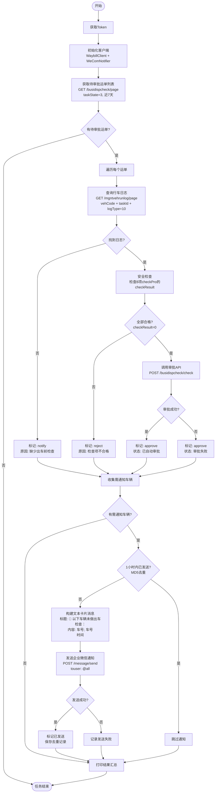

# 运单安全检查及审批流程

## 工作流图



## 流程说明

| 步骤 | 说明 | API |
|------|------|-----|
| 1 | 获取Token | TokenManager |
| 2 | 初始化客户端 | - |
| 3 | 获取待审批列表 | `GET /busidispcheck/page` |
| 4 | 查询行车日志 | `GET /mgntvehrunlog/page` |
| 5 | 安全检查 | 本地逻辑（checkResult=0为合格） |
| 6 | 审批通过 | `POST /busidispcheck/check` |
| 7 | 发送通知 | `POST /message/send` |

## 判定逻辑

### 出车前检查判定
```
if 无行车日志(logType=10):
    → notify (发送企业微信通知)
elif 8项检查中有checkResult≠0:
    → reject (驳回)
else:
    → approve (调用审批API)
```

### 通知去重逻辑
```
content_hash = MD5(sorted(veh_codes))
if 相同hash且间隔<3600秒:
    → 跳过
else:
    → 发送并记录
```

## 通知消息格式

**标题**: 📢 以下车辆未做出车检查：

**内容**:
```
鄂ACB379; 鄂A12345
2026-05-20 17:00:00
```

**接收人**: @all（全员）
